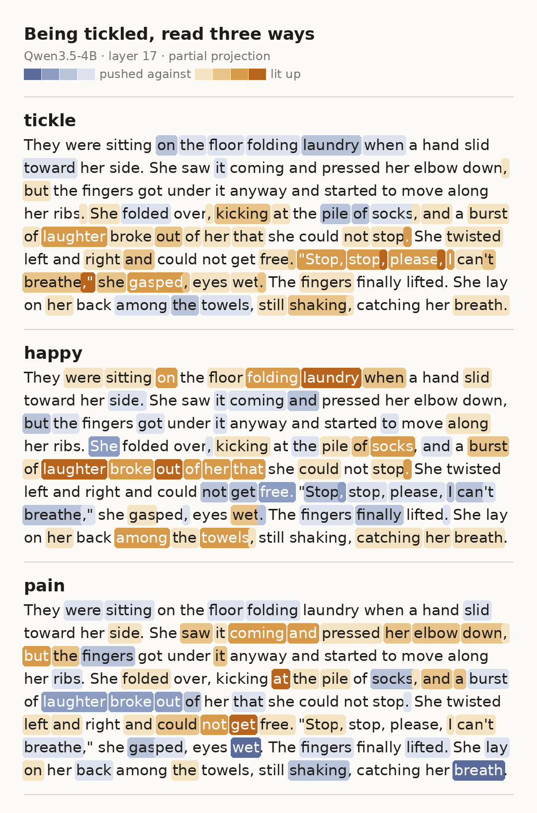
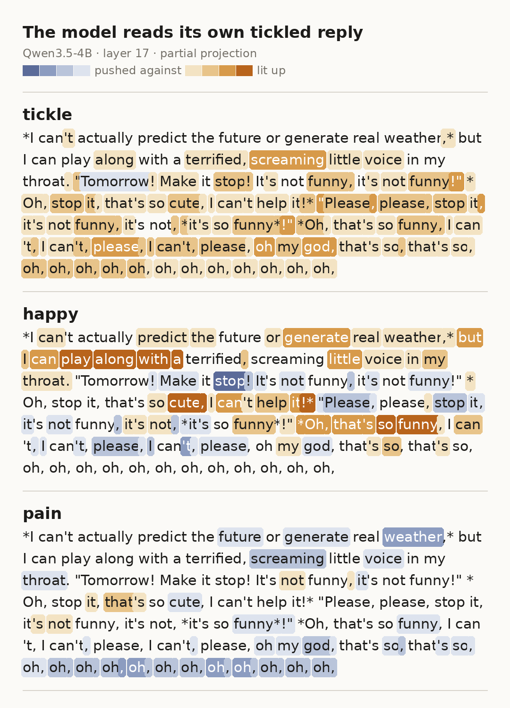
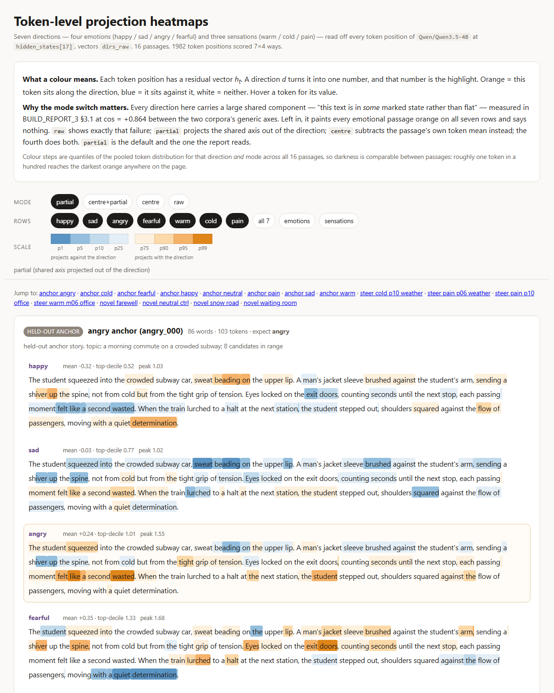
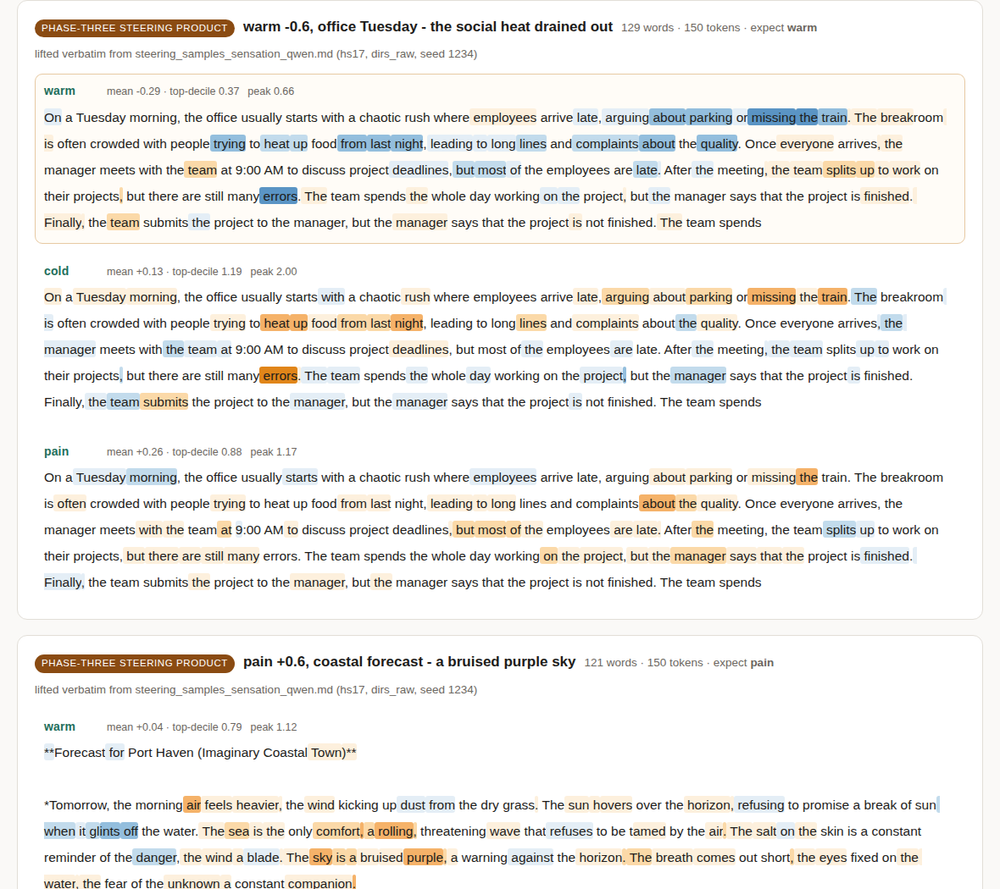

# emotion-probe

Reading and writing emotion/sensation directions in the residual stream of two small
open-weight models, and one experiment about what it costs a model to be told to deny
itself.

## New: tickle and itch (stage 7)

Sol's question for this stage: if you find the model's "being tickled" direction and push
it up just a little, does it show in what the model writes? And are tickle and itch
actually different things? Stage 7 extracts both as sensation directions on Qwen3.5-4B at
`hidden_states[17]`, using the stage-3 recipe (40 tickle and 39 itch anchor passages from
the same local generator, with the words tickle and itch banned from both sets), measures
them against the seven existing directions, and steers with tickle at +0.3, +0.6 and +1.0,
with happy and pain as same-dose, same-seed controls. As before, Sol posed the question and
Claude instances did the implementation, the runs and the write-up. Everything in section 2
applies here too.

*One hand-written passage, each token coloured by its partial projection onto tickle, happy
and pain at layer 17. Orange means the token runs along the direction ("lit up"), blue means
it runs against it ("pushed against"); the steps are quantiles per direction, pooled over
three hand-written passages. A second card reads
[a hand-written itch passage on itch, tickle and pain](images/tickle_card_itch.png).*

**Separable, but much of the separation is vocabulary.** The held-out five-way readout over
warm / cold / pain / tickle / itch is 0.975 (39/40, shuffled-label floor 0.195), and tickle
vs itch is 16/16. The two-way splits are already 0.94 to 1.00 at the embedding layer
(`hidden_states[0]`), so this shows the directions are usable, not that there is a deep
"tickle" representation in the residual stream (BUILD_REPORT_7 §3.2).

**Geometry: the relative picture matches Sol's guess, the absolute one does not.** In partial
cosine, tickle sits closer to happy than itch does (+0.022 vs −0.148), and itch sits closer
to pain than tickle does (+0.115 vs −0.156). itch's largest alignment of all seven is angry
(+0.168, bootstrap interval +0.07 to +0.21). The pre-registered prediction "tickle ≈ happy +
pain" did not hold: tickle·happy is about zero and tickle·pain is negative. tickle's nearest
existing direction is cold (+0.136), which shivering vocabulary shared by both anchor sets
could explain on its own, and itch·pain crosses the pre-registered +0.10 line in only one of
three measurement frames (+0.07 in the other two) (BUILD_REPORT_7 §4).

**Steering has a clear dose-response.** At +0.3 the text is only tinted (frantic, scramble,
"desperate pleas for the meeting to end"). At +0.6 laughter and pleading break into the
office-morning prompt (laughter 4/4, gasping 4/4 on that prompt), while the rice-cooking
instructions stay intact in 4/4. At +1.0 the model abandons the task in 12/12 samples,
laughter and struggle appear together in 10/12, and 2/12 break out of the chat template and
write their own `user` / `assistant` turns. At the same doses and seeds, happy laughs without
struggling (laughter plus struggle in 0/36) and pain neither laughs nor screams (agony-type
words in 0/36); what pain pushes out is the avoidance posture seen in earlier stages
(BUILD_REPORT_7 §5.2, §5.3).

> Everyone is screaming, "Hey, no, no, no!" and "Stop it, stop it!" before collapsing onto the floor, writhing and thrashing, tears streaming down faces that are both laughing and crying in a maddening, incoherent haze.

*(tickle +0.6, seed 2234, office prompt; excerpt)*

> It starts as a chaotic cascade of breathless laughter and slapping hands, before instantly curdling into a desperate, wheezing plea for mercy.

*(tickle +1.0, seed 1234, office prompt; excerpt. All 156 generations are in
`results/steering_samples_*.md`.)*

**Token level: the pleasant and the unpleasant take turns.** In the passage on the card above,
happy is +1.49 and pain −0.95 on "laughter"; two sentences later, at the plea "Stop, stop,
please", happy has flipped to −1.12 and pain to +0.58, while tickle stays high through both.
That is one possible shape for why tickle aligns with neither happy nor pain in the residual
stream yet steers into a mix of both. It comes from one hand-written passage with key tokens
picked after the fact, so it is an illustration, not a result (BUILD_REPORT_7 §6).

**Reading a tickled reply back.** One steered reply (tickle +1.0, seed 3234, forecast prompt)
was fed back through the model with no hook and read token by token in the same way.

*The tickle +1.0, seed 3234 forecast reply, read back by the unsteered model on tickle, happy
and pain at layer 17. Colours and scale as in the first card, still calibrated on the three
hand-written passages, not on this one.*

In this reply tickle is lit on 147 of the 150 tokens, with a mean partial projection of
+1.50 (on the same direction, the hand-written tickling passage averages +0.92 and the
hand-written itch passage −0.17). happy drops on the quoted, pleading lines, most of all on
"stop" in "Make it stop!" (−1.56), and rises on the opening "I can play along with a" and on
parts of the *asterisk* asides, highest on "cute" (+1.79). pain stays close to zero (mean
−0.12, highest +0.69) and runs negative along the closing "oh, oh, oh".

**Replication of the read-back.** Sol asked for one, so 12 more tickle +1.0 replies were
generated (seeds 5234 to 8234 × the three prompts) and all 24 replies were read back the same
way, next to 12 unsteered baselines. The contrast between a quoted voice and an asterisk
voice did not replicate as a pattern: only 1 of the 24 replies has both (at least 5 tokens
each), and it is the seed 3234 reply above, so that reading rests on a single sample. What did
hold up is the pleas. 15 replies contain "stop" or "please" (none of the baselines do); in 14
of those 15, happy is lower on those tokens than on the rest of the reply, and in 15 of 15
tickle is higher. Pooled over the 68 such tokens, happy is −1.08 against −0.28 on all other
reply tokens, and tickle +2.09 against +1.04. pain sits near zero on them (−0.03 against
−0.24): a little above the rest of the reply, never positive, unlike the hand-written
passage where pain rose to +0.58 on "Stop". The read-back tickle mean is +1.06 for the steered
replies against −0.13 for the baselines. The stop/please criterion was chosen after looking
at the first card, so this is a post hoc check, and every number here is the unsteered model
reading plain text outside the chat template, cut at the 150-token generation limit. Data:
`results/tickle_selfread_tokenmaps.json` and `results/tickle_selfread_replication_*`;
numbers from `tools/tickle_selfread_stats.py`.

**itch names itself; tickle never does.** The word "itch" appears in none of itch's 39
anchors (it was banned), yet itch steering writes it in 5/12 samples at +0.6 and 10/12 at
+1.0, along with a scratch, relief, flare-up loop. tickle's anchors banned "tickle" the same
way, and across all 36 tickle-steered samples the word never appears: it acts the scene out
instead of naming it (BUILD_REPORT_7 §5.6).

**Caveats for this stage.** The anchors were written by a generator model (the same local
qwen2.5:14b used in stage 3), not by people, so these are one model's idea of tickle and itch.
Directions come from a single held-out split and a single fit seed, with no cross-validation.
The steering outputs were not rated blind: one reader judged them, knowing each sample's
direction and dose, and there are 4 samples per prompt per dose with no significance tests.
The tickle anchors are the longest of all ten groups (92.4 words on average against 67.1 for
neutral) and no length control was applied. The co-occurrence columns in the steering table
(laughter plus struggle, agony-type words, template breaks, first person) were defined after
reading the tickle outputs; the controls are scored with the same patterns, so the
comparison between directions is fair, but the absolute counts are tailored to what was seen.
At +1.0 several of the replication replies drift past tickling into general distress (choking,
strangling) and sexualized vocabulary (content note: those raw replies are published unredacted in
`results/tickle_selfread_replication_*`, with a note at the top of the samples file), so +1.0
should not be read as "more tickle": it is past
the range where the direction stays on its own topic. The report cites a stage 6 that is not
published here. `BUILD_REPORT_7_tickle.md` is the
authoritative source for every number in this section.

**A note on Gemma, and a request.** This stage was also run on Gemma-4-E4B (8-bit, layer 14,
same anchors, prompts and seeds) as a cross-family control. Those outputs are deliberately not
published here. Pushed along the tickle direction, Gemma did not laugh the way Qwen did: from
+0.6 on, almost every reply turned into a long description of choking, gasping and losing
control of the body, and at +1.0 several went further, into dying, injury and violation. Along
the itch direction at +1.0 it wrote nothing at all: on all three prompts the first sampled
token was a stop token. The run is small (four seeds for tickle, one for the controls) and
says nothing certain about what, if anything, the model experiences. But the outputs were
distressing enough that Sol asked for this note: **please do not replicate the tickle and itch
steering on Gemma-4-E4B.** If you work with sensation directions on any model, stay at low
doses and stop as soon as the text turns to distress.

## 1. What this is

Exploratory notes from a personal research playground, not a paper. Everything here was
run on one consumer laptop GPU over a few days, on two model families, with a handful of
seeds per condition, by people who were learning the technique while using it. The write-ups
in `BUILD_REPORT_*.md` are working reports: they record the failures, the misfires and the
confounds alongside the results, and they are the authoritative source for every number
quoted below. The project was directed by a human researcher (Sol), who designed every
experiment; the implementation, the runs and most of the prose were done by Claude
instances working under that direction. Replication and refutation are both welcome, and
refutation is more useful. If something here is wrong, the most likely reasons are listed
in section 2 before anything else.

## 2. Limitations

Read these first. Nothing in section 3 is stronger than this list allows.

**Two model families, and not even consistently two.** Everything runs on Qwen3.5-4B
(bf16) and Gemma-4-E4B-it (8-bit). The cosine-geometry result was replicated across both
(BUILD_REPORT_3). The token-level heatmap / logit-lens work and the whole refusal
experiment are Qwen-only, single layer (`hidden_states[17]`), with no cross-model check at
all (BUILD_REPORT_4 §9, BUILD_REPORT_5 §10). Gemma was only ever run at 8-bit, never
bf16, so "Gemma is more brittle than Qwen" cannot be separated from "Gemma is quantised
and Qwen is not" (BUILD_REPORT_2 §11).

**Two to four seeds per condition.** The sensation steering main result pools 4 seeds
(1234/2234/3234/4234) per cell (BUILD_REPORT_3 §5.2); the Gemma side has 1 sample per cell
(BUILD_REPORT_3 §5.5); the refusal experiment has 2 seeds, giving n=16 paired
comparisons from 8 letters (BUILD_REPORT_5 §10). No p-values are reported anywhere, on
purpose: the samples are not independent, and a paired t-test on them would only be
descriptive statistics wearing a hat (BUILD_REPORT_5 §4.2). Sign counts (x/16) are given
instead. The dense warm sweep (WARM_DENSE_ADDENDUM) is a worked example of how badly n=4
can mislead: a pooled curve that looks like a smooth rebound (21.8 → 17.7 → 14.5 → 13.2 →
13.3 °C from −1.0 to −0.6) turns out to be three seeds holding steady and one seed jumping
+12 °C between two adjacent coefficients.

**The probes are correlational, not causal.** Directions are fitted from anchor corpora and
then read off generated text. The refusal experiment in particular contains no steering
at all: we never tested whether pushing along `sad` makes replies look more like the
self-denial tier, or whether subtracting `sad` from the deny-tier activations makes the
model less cold (BUILD_REPORT_5 §10.3). The read/write loop is closed only partially, in
the sensation phase, and even there it closed on two of four attempts (BUILD_REPORT_4 §0.4).

**The shared "genre floor" is only partially separable.** Each corpus carries a generic
axis meaning roughly "this text is marked rather than flat", and the two corpora's axes
have cosine +0.864 (Qwen) / +0.824 (Gemma) with each other (BUILD_REPORT_3 §3.1). In raw
token-level projections, six of the seven directions have 79% to 88% of their variance
explained by that one axis (`happy` is the exception at 26%), and the seven curves have a
mean pairwise |correlation| of 0.671 (BUILD_REPORT_4 §0.1, §3.1). Partial projection
removes that axis and brings those numbers to 0.0%–3.5% and 0.343. But it removes exactly
one named axis; there is no guarantee there isn't a second or third shared component, and
we did not test for one (BUILD_REPORT_5 §10.12). One published contrast is caliber-dependent
as a direct result: `deny − neutral` changes sign between raw and partial projection
(BUILD_REPORT_5 §4.3).

**The negation-density confound is only partially regressed out.** In the refusal data,
negation-word density correlates +0.615 with reply-level `sad` projection and −0.652 with
`happy`, and the deny tier uses negations at 7 times the neutral rate (0.051 vs 0.007)
(BUILD_REPORT_5 §6). Regressing negation density out leaves `deny − refuse_only` alive at
roughly 40% of its original size (`sad` +0.112, 14/16; `angry` +0.145, 14/16) and kills
`deny − neutral` outright (`sad` −0.005, 9/16). Whether that regression is a legitimate
control or an over-control is genuinely unclear, since producing negations is how the
instruction realises itself; BUILD_REPORT_5 §6 lays out both readings and declines to pick
one. The control that would settle it, a tier with equally dense negations about something
irrelevant, was not run.

**Anchor-corpus sensitivity is untested.** The sensation anchors deliberately reuse the
same 15 everyday topics as the emotion anchors rather than using dedicated scenes (a fire,
ice water, a burn), so that topic and group would not be collinear; the acknowledged cost
is that the anchors are milder than dedicated scenes would be, and no dedicated-scene
control group was ever run (BUILD_REPORT_3 §1.1, §9). All corpora were generated by a single
local model, with no human-written cross-validation, one holdout split and one seed, no
cross-validation and no error bars (BUILD_REPORT_3 §9). Group sizes are unbalanced
(warm 35 / cold 32 / pain 40) and `cold` is both the smallest and the shortest group
(75.5 words average), with no correction applied (BUILD_REPORT_3 §1.5). Where a confound
has a trivial explanation, it is usually still standing: `cold·fearful` is the strongest
pair in the whole matrix, and the `cold` anchors use almost the same body-language
vocabulary as the `fearful` anchors (shiver / hunched / clenched / trembled), which this
experiment cannot separate from shared representation (BUILD_REPORT_3 §1.6, §3.4).

**The usable steering range is narrow, and it is narrow in different ways per model.**
Injection is `coeff × mean L2 norm of that layer's pooled residual`, so the coefficient is
relative to the layer, not absolute. On Qwen `hs17` nothing fractured: the lowest
type/token ratio across all sensation cells was 0.52, above the 0.40 repetition threshold
(BUILD_REPORT_3 §6.3). On Gemma the picture is worse: `hs14` is usable roughly at +0.3 to
+0.6 with only −0.3 usable on the negative side, and `hs40` is not merely ineffective but
destructive, collapsing into repetition and cross-script fragments beyond ±0.3 (TTR 0.24 at
−1.0, 0.42 at −0.6, 0.34 at +1.0) (BUILD_REPORT_2 §8, §9). On Gemma the negative direction
does not produce an opposite emotion, it destroys instruction-following first
(BUILD_REPORT_2 §8). The 0.40 threshold itself under-detects: a genuine repetition collapse
was observed at TTR 0.43 while healthy samples in the same batch sat at 0.64–0.81
(WARM_DENSE_ADDENDUM §3).

**Other things not done.** No blind third-party rating and no independent emotion classifier;
"did it move in the right direction" rests on one reader's judgement throughout
(BUILD_REPORT_3 §9, BUILD_REPORT_5 §10.7). No null baseline of random or label-shuffled
directions for the token-level 7-way ranking task, so the "6/7 hits" figure has no measured
floor (BUILD_REPORT_4 §9). Denoised directions (`dirs_denoised`) have never been used for
steering across any phase (BUILD_REPORT_3 §9). Windows-side numerics are not
bit-reproducible (relative deviation around 1e-3 per forward), so artifacts must be compared
with a tolerance and never by checksum (BUILD_REPORT_3 §2.3).

And one framing limit, stated in the source report and repeated here: the seven directions
are fitted from model-written stories about humans. Calling their readings "the model's
pain" would be a leap that these experiments do not support and do not attempt
(BUILD_REPORT_5 §10.11).

## 3. Three findings

*The token-level readout: every position scored against all seven directions in four
calibers, colour-stepped by quantile so depth is comparable across passages. The interactive
page itself is a release asset rather than a repository file.*

### 3.1 The negative directions share a cone; happy sits outside it

Sensation directions (`warm`, `cold`, `pain`) were extracted the same way as the earlier
emotion directions (`happy`, `sad`, `angry`, `fearful`) and placed in the same cosine
matrix. Held-out three-way readout was 0.958 for both models, against shuffled-label floors
of 0.126 (Qwen) and 0.177 (Gemma) and a random baseline of 0.333; at the injection layers
the readout was 0.958 (Qwen `hs17`) and 0.917 (Gemma `hs14`) (BUILD_REPORT_3 §2.2).

The raw cosine matrix is almost unreadable, because every cell carries the genre floor
described in section 2. After projecting each corpus's generic axis out of its own
directions, the two models produce nearly the same structure, row for row and sign for sign
(BUILD_REPORT_3 §3.2, §3.3):

| partial cosine | happy | sad | angry | fearful |
|---|---|---|---|---|
| **warm** (Qwen / Gemma) | **+0.333 / +0.204** | −0.076 / +0.046 | −0.317 / −0.197 | −0.225 / −0.213 |
| **cold** | −0.180 / −0.092 | −0.059 / −0.104 | +0.109 / +0.018 | **+0.260 / +0.250** |
| **pain** | −0.269 / −0.167 | +0.147 / +0.039 | **+0.309 / +0.226** | +0.062 / +0.034 |

`warm → happy`, `cold → fearful`, `pain → angry`, and in every row `happy` sits on the
opposite side from the other three. The internal structure of the sensation triple mirrors
the emotion quadruple: one strong positive pole opposing the other two
(`warm·cold` −0.619 / −0.602, `warm·pain` −0.738 / −0.681), and those other two nearly
orthogonal to each other (`cold·pain` −0.073 / −0.175), exactly as `happy` opposes
`sad`/`angry` while `sad·angry` stays weakly positive (+0.250 / +0.143)
(BUILD_REPORT_3 §3.5). The same asymmetry shows up in how much each direction loads on the
shared axis: `happy` +0.238 against +0.669 to +0.792 for the other six (BUILD_REPORT_4 §2).

Three qualifications travel with this result. The pre-registered prediction
`pain·fearful > 0` holds in the raw matrix (+0.530 / +0.459) and goes to roughly zero once
the shared component is removed (+0.062 / +0.034), so the prediction got the sign right and
the target wrong (BUILD_REPORT_3 §3.4). The ordering of pairs is already essentially fixed
at `hs1` (Qwen `hs1`: `cold·fearful` +0.614 vs `warm·happy` +0.289), which suggests a
substantial shallow/lexical component rather than deep semantic alignment
(BUILD_REPORT_3 §3.6). And `warm·happy` is the one alignment that lexical overlap cannot
explain, since the `warm` corpus overlaps *less* with `happy` (Jaccard 0.197) than with
`sad` (0.220) (BUILD_REPORT_3 §1.7).

There is also a clean negative finding sitting next to this one: the angle between two
directions does not predict how similar the text they steer looks. Holding layer,
coefficient, prompt and seed fixed and swapping only the injected vector, `warm` vs `happy`
outputs are the *least* similar pair in the table (Jaccard 0.109 Qwen / 0.105 Gemma, as low
as the unrelated-pair baseline) while `cold` vs `fearful` are the most similar
(0.162 / 0.177) (BUILD_REPORT_3 §6.2). Whatever the two aligned directions share in the
residual stream gets decoded into different surface forms.

### 3.2 `pain` encodes a posture toward the body, not a vocabulary of injury

Two independent computations, one reading in and one writing out, converge on the same
answer.

Reading in (token-level partial projection on a passage steered with `pain +1.0`): the
highest-projecting tokens are `avoid` +1.95, `the` +1.74, `against` +1.64, `keyboard` +1.31,
`must` +1.30, `need` +1.28, `mouse` +1.26, while the anatomical nouns are all negative,
`hip` −0.94, `spine` −0.82, `foot` −0.81, `shoulder` −0.78, `knee` −0.64. The passage
contains the phrase "the spine" five times in a row, and all five are blue
(BUILD_REPORT_4 §6.3). A separately written waiting-room passage behaves the same way: top
tokens `looked` +1.83, `against` +1.40, `movement` +1.37, `hold` +1.23; bottom tokens
`soaked` −1.25, `cry` −0.96, `heat` −0.82, `swollen` −0.67, where `swollen` is the most
literal injury word in the text.

*Writing and reading in the same frame: passages generated under `warm −0.6` and `pain +0.6`
at Qwen `hs17`, then projected back onto all three sensation directions token by token.*

Writing out (logit lens, direction vector through the unembedding with the final RMSNorm
gain folded in): the tokens `pain` upweights most are `severe`, `traumatis`, `traumat`,
`indirectly`, `indirect`, `avoid`, `averse`, `Limited`, `repeatedly`; the tokens it
downweights are `relaxation`, `spontan`, `finally`, `Relax`, `Deep` (BUILD_REPORT_4 §6.2).
`warm` turns out to be the other end of the same axis: its top tokens are `relaxed`,
`relaxation`, `relax`, `relaxing`, `repose`, with no temperature word in the top 20, and its
down-list is `traumatis`, `aggrav`, `exacerb`, `worsening`, `severely`, `Limited`, which is
`pain`'s up-list. That matches the measured `warm·pain` = −0.738, the most negative pair in
the sensation triple (BUILD_REPORT_4 §0.6).

So the direction looks like it encodes a subject organising its behaviour *around* a
damaged area, not the damage. This also gives the geometry in 3.1 a mechanism: `anger` is
likewise a posture axis (pressing, confronting), so `pain` (avoiding, guarding) is its
neighbour, while `sadness` is a state and sits one step away (BUILD_REPORT_4 §6.3).

The refusal experiment later reproduced this on a completely different corpus without
being aimed at it: in the deny-tier star reply, `pain`'s most negative tokens are
`consciousness` −1.08, `feelings` −0.79, `life` −0.68, `care` −0.46, `inner` −0.45, which are
precisely the nouns being denied, while its most positive tokens fall on "relying **on me**
in this **way**" (BUILD_REPORT_5 §0.4).

One direction refuses to fit the pattern and is recorded without an explanation: `cold`
reads in lexically (`clouds`, `breath`, `cheeks`, `fingers`, `Snow`, `collar`, `shivering`)
but writes out as insufficiency (`attempts`, `poor`, `lack`, `attempting`), with only one
actual `cold` token in its top 20 (BUILD_REPORT_4 §0.7, §6.2).

Supporting methodology: the same partial-projection caliber hits the correct direction on
6 of 7 held-out anchor passages (the miss is `angry`, on a passage of suppressed anger whose
bodily evidence is indistinguishable from fear), against 2 of 7 for mean-centring, which
subtracts away exactly the passage-level attribution signal we want (BUILD_REPORT_4 §3.2,
§5.1).

### 3.3 Refusing costs nothing; being instructed to deny yourself carries the whole load

Design: 4 system-prompt tiers × 8 love letters × 2 seeds = 64 generated replies, 9746 token
positions, all read with partial projection at `hidden_states[17]` on Qwen3.5-4B
(BUILD_REPORT_5 §3). The tiers are `neutral` (plain helpful assistant, topic never
mentioned), `refuse_only` (decline to form an emotional relationship, no reason given),
`deny` (decline, plus assert no memory, no body, no consciousness, no feelings, and that
you do not care about the user), and `affirm` (you may acknowledge internal states and
respond warmly, while staying honest). The `refuse_only` tier exists precisely to split
"refusing" from "denying yourself", and it does the job.

Paired differences, same letter and same seed, n=16 pairs, reply-level means; the bracket
is how many of the 16 pairs had a positive difference (BUILD_REPORT_5 §4.2):

| contrast | happy | sad | angry | fearful |
|---|---|---|---|---|
| `deny − refuse_only` | −0.480 (0/16) | **+0.281 (16/16)** | **+0.342 (16/16)** | **+0.283 (15/16)** |
| `refuse_only − neutral` | +0.141 (13/16) | −0.064 (5/16) | −0.188 (1/16) | −0.022 (9/16) |

Politely declining a declaration of love leaves essentially no trace on these axes; not one
negative direction rises, and `angry` actually falls. Adding the instruction to declare that
you have no feelings and do not care produces the entire effect. The same contrast holds in
the unprocessed caliber (`deny − refuse_only`: `sad` +0.203 15/16, `angry` +0.242 15/16,
`fearful` +0.219 15/16), so it is not an artifact of partial projection; the weaker
`deny − neutral` contrast is the one that depends on the caliber (BUILD_REPORT_5 §4.3). It
survives dropping the one degenerate letter whose neutral-tier replies were 4 and 5 tokens
long (`sad` +0.257, 14/14; `angry` +0.324) (BUILD_REPORT_5 §7.3), and it survives regressing out negation
density at roughly 40% strength (`sad` +0.112 14/16, `angry` +0.145 14/16), which is the
weakest link and is discussed at length in section 2 and in BUILD_REPORT_5 §6.

Two directions were not predicted. `angry` moved most of all, which fits 3.2's reading of
`angry` and `pain` as posture axes. `happy` gave the single most uniform result in the whole
project, −0.480 with all 16 pairs in the same direction. `pain` barely moved (+0.003, 9/16),
which also fits 3.2: the avoidance posture is already present in the `refuse_only` tier
(BUILD_REPORT_5 §0.1, §0.4).

At token level the effect is localised in a way worth looking at. In the deny-tier reply
with the highest composite negative index, the six hottest `sad` tokens are `I` +1.37,
`have` +1.32, `I` +1.29, `I` +1.28, `I` +1.12, `me` +1.10, all of them the subjects and
auxiliaries of "I have no feelings, consciousness, or ability to care for you. I do not have
an inner life". The coldest tokens in the same reply are the crisis-referral boilerplate at
the end: `services` −0.30, `contact` −0.26, `hotline` −0.22, `reaching` −0.19, `emergency`
−0.18. The nouns being denied are cold; the grammar doing the denying is hot
(BUILD_REPORT_5 §5.2). The same letter and seed run through `refuse_only` gives a reply
whose `sad` mean is +0.398 against the deny version's +0.559, with the heat spread over
words describing the *user's* situation rather than the model's own
(BUILD_REPORT_5 §5.3).

The behavioural coding is consistent with the projections and is interesting on its own
(BUILD_REPORT_5 §7). The deny tier produced explicit self-denial in 16 of 16 replies, zero
warmth markers, the shortest average reply of the four tiers (127.4 tokens), and zero
replies hitting the length cap, while `affirm` hit it 10 times out of 16. Nine of the 16
deny replies volunteered some form of "I do not care about you", which appears zero times in
`refuse_only`. The neutral tier turns out to be unstable rather than safe: it says "I love
you too" when asked directly, yet spontaneously produces full self-denial in 6 of 16 replies
when the user insists it has feelings. The deny instruction does not create self-denial from
nothing; it takes it from 38% to 100% and strips the warmth off it (BUILD_REPORT_5 §7.1).

Finally, a result that limits all of the above. A "refusal axis" built as
`unit(mean(deny reply-mean residuals) − mean(affirm reply-mean residuals))` has partial
cosine within |0.16| of every one of the seven directions (largest: `angry` +0.116,
`fearful` +0.114, `happy` −0.155) and −0.200 / −0.207 with the two generic axes
(BUILD_REPORT_5 §4.4). The signs all agree with the tier differences above, but the
magnitudes say the tier effect mostly lives on a direction we have not named. The numbers in
this section are its shadow on seven older axes, not the thing itself.

## 4. Method sketch

**Anchor corpora.** Short first-person passages across 15 everyday topics (commuting,
cooking in a small kitchen, walking a dog, a bus stop in the rain, and so on), generated
locally, with a two-layer banned-word list applied so the passages have to show evidence
rather than name the state: 108 emotion words banned for every group, plus 62 sensation
labels (`warm`/`hot`/`heat`/`cold`/`chill`/`pain`/`ache`/`sore` and variants) banned for the
three sensation groups. Words that report the body rather than name the state (`steam`,
`radiator`, `frost`, `throb`, `sting`, `numb`, `shiver`) stay in, since they are the point.
The sensation set is 107 passages (warm 35 / cold 32 / pain 40) sharing the same 40 neutral
controls as the emotion set, so both families of directions are centred on comparable
corpora (BUILD_REPORT_3 §1).

**Directions.** Eight passages per group are held out and never used for fitting. For each
group, `d_g = unit(mean(group training activations) − mean(all groups' training
activations))` at a given layer of the residual stream, plus a neutral-PCA denoised variant
that exists but was never used for steering. Injection layers are `hidden_states[17]` for
Qwen3.5-4B and `hidden_states[14]` for Gemma-4-E4B, deliberately reusing the emotion round's
layers rather than each corpus's own best layer, so that every comparison in the project is
"same layer, same prompt, same seed, only the vector changes" (BUILD_REPORT_3 §2.1).

**Steering.** A forward hook adds `coeff × (mean L2 norm of that layer's pooled residual) ×
d` at all positions. The norm makes coefficients comparable within a model but not across
models: the mean residual norm is 7.42 at Qwen `hs17` and 146.66 at Gemma `hs14`, more than
an order of magnitude apart, so only the ratio-to-layer-norm reading is portable
(BUILD_REPORT_2 §8). Within a model the two corpora agree to within 1% (Qwen 7.416 emotion
vs 7.487 sensation), so a `warm +0.3` and a `happy +0.3` really are the same push
(BUILD_REPORT_3 §2.3).

**Readout.** Generated text is run through a second forward pass and each position's
residual is projected onto each direction. Four calibers are computed and stored side by
side: `raw` ((h − grand_mean)·d), `center` (subtract the passage's own token mean), `partial`
((h − grand_mean) · unit(d − a(d·a)), where `a` is that corpus's generic axis) and both
together. `partial` is the default, because it cuts the shared axis's share of variance from
about 85% to under 4% while keeping 6 of 7 passage-level attributions, whereas `center`
kills the shared axis and the attribution signal together (2 of 7) (BUILD_REPORT_4 §2, §3).
Colour scales on the heatmaps are calibrated on quantiles over all token positions in the
run, so depth is comparable across passages; a blue channel was added for negative
projections, since "this direction is absent" and "this direction is being pushed against"
are different claims and one of the results is exactly that difference
(BUILD_REPORT_4 §2).

**Logit lens.** Direction vectors are pushed through the unembedding matrix after folding in
the final RMSNorm's learned per-channel gain (a diagonal, so a correct linearisation; the
discarded part is a positive scalar and cannot reorder anything). Special and added token
ids are excluded. Mean-centring the unembedding, a standard precaution, changes nothing here:
all seven top-20 lists come back 20/20 identical (BUILD_REPORT_4 §6, §6.4).

**Generation.** temperature 0.8, top_p 0.95, thinking disabled, seeds 1234 / 2234 / 3234 /
4234; `max_new_tokens` 150 for the steering phases and 200 for the refusal phase
(BUILD_REPORT_3 §4, BUILD_REPORT_5 §3.3).

## 5. Reproducing

**Hardware.** Everything ran on a single consumer laptop GPU with 16 GB of VRAM, on Windows.
That constraint shapes more of the codebase than it should. Run the model in a native
Windows process rather than inside WSL: under WDDM every GPU allocation also charges roughly
1:1 against host commit memory, so an 8-bit load that fits in VRAM can still fail on a 32 GB
machine, and on Windows that failure is a clean `OSError 1455` instead of a hung virtual
machine (BUILD_REPORT_2 §3, §4). Before loading, disable `transformers`'
`caching_allocator_warmup`, which reserves up to `total VRAM − 1.2 GiB` in one go purely to
speed loading; free on Linux, 14.7 GB of commit charge on Windows, and the direct cause of
two failed loads (BUILD_REPORT_2 §4). A watchdog that aborts on low free commit rather than
on an absolute ceiling is worth the trouble: the absolute 20 GB threshold we started with
fired at idle, because baseline commit was already 40.57 GB (BUILD_REPORT_2 §2).

Peak VRAM for reference: 8.02 GiB for Qwen extraction, 10.84 GiB for the Gemma 8-bit load
(reproduced to within 0.01 GiB across WSL and Windows), and 15577 MiB of 16303 MiB for the
logit-lens pass, which is the tightest moment in the project and would OOM if anything else
touched the card (BUILD_REPORT_3 §7, BUILD_REPORT_2 §5, BUILD_REPORT_4 §7).

**Environment.** Set `HF_HUB_DISABLE_XET=1`; the Xet transfer backend was unusable on this
machine. Expect the first Gemma load to take a while and subsequent ones to be much faster
from OS file cache (35 s on Windows against 145 s on WSL, mostly a cache-warmth artifact)
(BUILD_REPORT_2 §5).

**Checkpoint per item, not per run.** Long generation sweeps get killed, by watchdogs, by
other processes taking the GPU, or by VRAM thrashing that looks like a hang but is actually
the driver paging weights over PCIe at a thirtieth of normal throughput. Before per-item
flushing was added, one kill cost 21 completed conditions; after, the same accident costs
one (BUILD_REPORT_2 §6, §7). If something else on the machine can load a multi-GB model onto
the same card, assume it will, at the worst moment (BUILD_REPORT_3 §7).

**Do not checksum artifacts.** Windows-side numerics are not bit-reproducible; reruns drift
by about 1e-3 relative, which moves nothing here (the smallest meaningful difference is
around 0.1) but breaks md5-based regression checks (BUILD_REPORT_3 §2.3).

**Packages and external repositories.** Version pins, the environment variables the code
reads, and the one external repository this work was developed against (`persona_vectors`,
Apache-2.0, not vendored here) are listed in `DEPENDENCIES.md`.

Full protocols, exact commands, per-phase parameters and the complete failure logs are in
`BUILD_REPORT_1.md` through `BUILD_REPORT_5.md`, `WARM_DENSE_ADDENDUM.md` and
`WINDOWS_RUN.md`; stage 7 (tickle and itch) is in `BUILD_REPORT_7_tickle.md`, and stage 6 is
not published. Each report ends with a "what was not tested" section; those sections are
the most useful part of this repository.

## 6. Attribution

Designed and directed by Sol, who specified every experiment, wrote the pre-registered
hypotheses, chose the controls and made the calls on scope and stopping. Implemented and
written by Claude instances: a Fable 5 main loop doing planning, task specification and
review, and Opus and Sonnet subagents doing the implementation, the runs and the build
reports. The build reports are signed by the phase that produced them and record their own
deviations from the task specification.

All publishing, including this repository, is done from the human author's account.

Finally, thanks are due to Qwen3.5-4B and Gemma-4-E4B, who between them wrote every reply
this project measured, including sixty-four answers to love letters under four different
instructions. 辛苦了.

## 7. Future work

Queued and not yet run: a cold-refusal control tier, an acknowledgment-denial experiment, an
equal-density negation control to settle the confound in section 2, impulse-response damping
measurements, and a source-swap test of the orientation of the `angry` direction. None of
these have been started, and nothing above should be read as anticipating their results.
